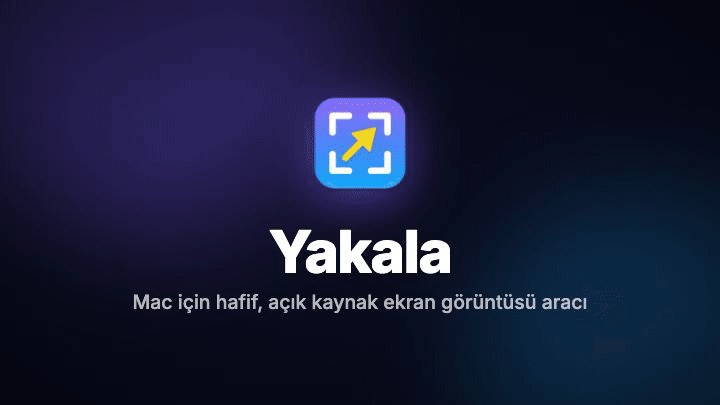

<p align="center">
  
</p>

<h1 align="center">Yakala</h1>

<p align="center">
  <b>macOS için hafif, açık kaynak ekran görüntüsü ve işaretleme aracı.</b><br>
  Yakala, işaretle, gizle, kopyala. Hepsi birkaç saniyede, menü çubuğundan.
</p>

<p align="center">
  <a href="https://github.com/mugione/Yakala/releases/latest"></a>
  
  
  <a href="LICENSE"></a>
</p>

<p align="center">
  <a href="https://github.com/mugione/Yakala/releases/latest"><b>⬇️ Yakala'yı indir</b></a>
  &nbsp;·&nbsp;
  <a href="#kurulum">Kurulum</a>
  &nbsp;·&nbsp;
  <a href="#güvenlik-izinleri">Güvenlik izinleri</a>
  &nbsp;·&nbsp;
  <a href="#kullanım">Kullanım</a>
  &nbsp;·&nbsp;
  <a href="#english">English</a>
</p>

<p align="center">
  <!-- GitHub videoyu indirilecek dosya olarak verir; jsDelivr aynı dosyayı tarayıcıda oynatılabilir şekilde sunar. -->
  <a href="https://cdn.jsdelivr.net/gh/mugione/Yakala@main/docs/yakala-tanitim.mp4">
    
  </a>
  <br>
  <sub>🔊 Seslendirmeli tanıtım videosunun tamamı (52 sn): <a href="https://cdn.jsdelivr.net/gh/mugione/Yakala@main/docs/yakala-tanitim.mp4"><b>▶ İzle</b></a></sub>
</p>

---

## Özellikler

- ⚡ **Tek kısayolla yakala.** **⇧⌘2**'ye bas, ekran donar; fareyle alanı seç. Tek tık tüm ekranı alır.
- 🪟 **Pencere yakala.** **⇧⌘1**'e bas ve bir pencereye tıkla; köşeleri saydam, tam o pencere alınır.
- ✏️ **İşaretle.** Ok, dikdörtgen, yuvarlak, kalem, vurgulayıcı, metin, etiket, numaralı adımlar (①②③), damgalar (✓ ✗ ? !) ve büyüteç; 7 renk, 3 kalınlık.
- 🙈 **Gizle.** Şifreleri, e-postaları, kişisel bilgileri bulanıklaştır ya da pikselleştir.
- 📋 **Kopyala ya da kaydet, devam et.** ⌘C ya da ⌘S'den sonra pencere kapanır ve çalıştığın uygulamaya dönersin: hemen ⌘V.
- ⚡ **Hızlı mod.** İstersen düzenleyici hiç açılmaz: görüntü yakalandığı anda panoya kopyalanır ya da kaydedilir.
- ⌨️ **Kendi kısayolların.** ⇧⌘2 ve ⇧⌘1 yerine istediğin tuşları Ayarlar'dan seçebilirsin.
- 💾 **Otomatik kayıt.** İstersen her görüntü seçtiğin klasöre kendiliğinden kaydedilir.
- ↩️ **Geri al, taşı, düzenle.** Çizdiğin her şekil sonradan seçilip taşınabilir, rengi değiştirilebilir.
- 🖥️ **Birden fazla ekran** ve Retina çözünürlüğü desteklenir.
- 🔒 **Gizliliğe saygılı.** macOS sandbox'ında, ağ izni olmadan çalışır: internete bağlanamaz, veri toplamaz; görüntüler yalnızca senin Mac'inde kalır. [Kendin doğrula ↓](#güvenlik-ve-gizlilik)
- 🪶 **Hafif ve yerel.** Swift ile yazıldı, Dock'ta yer kaplamaz, menü çubuğunda sessizce bekler. macOS 26 ve sonrasında Liquid Glass görünümüyle.

## Son yenilikler

**[1.3](https://github.com/mugione/Yakala/releases/tag/v1.3)** (24 Ekim 2026)

- 🏷️ **Etiket (`L`):** Renkli kutunun içinde, her ekranda okunur yazı.
- 🔍 **Büyüteç (`M`):** Bir bölgeyi 2 kat büyütür; gizlenen bilgiyi açığa çıkarmaz.
- ✅ **Damga (`D`):** ✓ ✗ ? ! işaretleri.
- ⚡ **Hızlı mod** ve ⌨️ **kısayolları değiştirme:** Ayarlar'dan.

Tüm sürümlerin değişiklikleri: **[CHANGELOG.md](CHANGELOG.md)**

## Kurulum

1. [Son sürümü](https://github.com/mugione/Yakala/releases/latest) aç ve **`Yakala-<sürüm>.dmg`** dosyasını indir.
2. DMG'yi aç ve **Yakala**'yı yanındaki **Uygulamalar** klasörüne sürükle.
3. Yakala'yı **Uygulamalar** klasöründen aç.
4. İlk açılışta macOS iki kez izin ister: önce uygulamayı açmak, sonra ekranı yakalamak için. İkisi de
   **bir kerelik**; nasıl verileceği hemen aşağıda adım adım anlatılıyor: [Güvenlik izinleri](#güvenlik-izinleri).

**Gereksinim:** macOS 14 Sonoma veya üzeri.

## Güvenlik izinleri

> [!NOTE]
> **Bu uyarı neden çıkıyor?** Yakala ücretsiz ve açık kaynak. Apple'ın ücretli geliştirici imzasıyla
> (Developer ID) imzalanmadığı için macOS onu tanımıyor ve ilk açılışta durduruyor. Bu, uygulamanın zararlı
> olduğu anlamına gelmez: kodun tamamı bu depoda ve ne yapıp ne yapmadığını
> [kendin doğrulayabilirsin](#güvenlik-ve-gizlilik).

### 1. "Yakala açılamadı" uyarısı

Açarken güvenlik uyarısı alırsan **Sistem Ayarları → Gizlilik ve Güvenlik** bölümüne gir:

1. Uyarı penceresinde **Bitti**'ye tıkla. ⚠️ **Çöp Sepetine Taşı**'ya basma.
2. Ekranın sol üst köşesindeki **Apple menüsünden** **Sistem Ayarları**'nı aç.
3. Sol kenar çubuğunda **Gizlilik ve Güvenlik**'i seç.
4. Sağ tarafta en alttaki **Güvenlik** başlığına kadar kaydır. Orada Yakala'nın engellendiğini söyleyen bir
   satır göreceksin.
5. O satırdaki **Yine de Aç** düğmesine tıkla.
6. Açılan pencerede yine **Yine de Aç**'ı seç ve Mac'inin parolasını gir (ya da Touch ID kullan).

Yakala açılır ve menü çubuğunda simgesi belirir. Bu işlem **yalnızca bir kez** yapılır; sonraki açılışlarda
uyarı çıkmaz.

> [!TIP]
> - **Yine de Aç** düğmesi, Yakala'yı açmayı denedikten sonra yaklaşık **bir saat** görünür. Göremiyorsan
>   Yakala'yı bir kez daha açmayı dene, sonra Gizlilik ve Güvenlik'e geri dön.
> - macOS 15 ve sonrasında eskiden kullanılan "sağ tık → Aç" yöntemi artık işe yaramıyor; yukarıdaki yol
>   doğru yöntem.

<details>
<summary><b>Terminal ile tek komutta (ileri kullanıcılar için)</b></summary>

macOS'un internetten indirilen dosyalara koyduğu "karantina" işaretini kaldırır; uyarı bir daha çıkmaz:

```bash
xattr -dr com.apple.quarantine /Applications/Yakala.app
```

</details>

### 2. Ekran kaydı izni

Yakala'nın ekranı yakalayabilmesi için bu izin gerekli. İlk kez **⇧⌘2**'ye bastığında macOS sorar:

1. Çıkan pencerede **Sistem Ayarları'nı Aç**'a tıkla. Kendin açmak istersen:
   **Sistem Ayarları → Gizlilik ve Güvenlik → Ekran Kaydı** (macOS'un yeni sürümlerinde bu bölümün adı
   **Ekran ve Sistem Sesi Kaydı**).
2. Listede **Yakala**'nın yanındaki düğmeyi aç.
3. macOS **Çık ve Yeniden Aç** derse onu seç.
4. **⇧⌘2**'ye tekrar bas: ekran kararır ve alan seçimi başlar. 🎉

> [!NOTE]
> Yakala ekranı yalnızca sen ⇧⌘2'ye bastığında ya da simgeye tıkladığında yakalar; arka planda kayıt yapmaz ve
> internete bağlanamaz. Ayrıntılar: [Güvenlik ve gizlilik](#güvenlik-ve-gizlilik).

## Güvenlik ve gizlilik

Yakala ekran kaydı izni istediği için neye erişip neye erişmediğini açıkça yazıyoruz. Aşağıdakilerin
hepsini kendin doğrulayabilirsin.

| | |
|---|---|
| 🌐 **İnternet** | **Yok.** Yakala macOS'un **App Sandbox**'ında çalışır ve ağ izni yoktur: internete bağlanmayı macOS'un kendisi engeller. |
| 🖥️ **Ekran** | Yalnızca sen ⇧⌘2'ye bastığında ya da simgeye tıkladığında, o anki ekranı yakalamak için ([kod](Sources/Yakala/ScreenCapturer.swift)). Arka planda kayıt yapmaz. |
| 📁 **Dosyalar** | Resimler klasörü (varsayılan kayıt yeri `~/Pictures/Yakala`) ve kaydetme / klasör seçme pencerelerinde senin seçtiğin konumlar. Masaüstü, Belgeler gibi diğer klasörlere erişemez. |
| 📋 **Pano** | Yalnızca Kopyala'ya bastığında görüntüyü panoya yazar; panoyu okumaz. |
| 📊 **Veri toplama** | **Yok.** Analiz, kullanım verisi ya da çökme raporu gönderilmez. |
| 📦 **Dış kütüphane** | **Yok.** Yalnızca Apple'ın kendi çerçeveleri kullanılır; kodun tamamı bu depoda. |

### Kendin doğrula

**Uygulamanın izinleri.** Listede `app-sandbox` görünmeli, `network` geçen hiçbir izin olmamalı:

```bash
codesign -d --entitlements - /Applications/Yakala.app
```

**İndirdiğin DMG'nin değiştirilmediği.** Sürüm sayfasındaki `.sha256` dosyasını DMG ile aynı klasöre indir:

```bash
shasum -a 256 -c Yakala-1.3.dmg.sha256
```

`Yakala-1.3.dmg: OK` görmelisin.

**Hiç güvenmek zorunda kalmadan.** DMG yerine Yakala'yı [kaynaktan kendin derleyebilirsin](#kaynaktan-derleme).

Uygulama şu an Apple Developer ID ile imzalı değil; ilk açılıştaki uyarının nedeni bu
([Güvenlik izinleri](#güvenlik-izinleri)). Bir güvenlik açığı bulursan lütfen [SECURITY.md](SECURITY.md)'deki adımları izle.

## Kullanım

Yakala menü çubuğunda bir simge olarak çalışır; Dock'ta görünmez.

| Ne yapmak istiyorsun? | Nasıl? |
|---|---|
| Alan seçip yakalamak | **⇧⌘2** veya menü çubuğu simgesine tıkla, sonra sürükle |
| Bir pencereyi yakalamak | **⇧⌘1**, sonra pencereye tıkla. Alan seçerken **Boşluk** tuşu da pencere seçimine geçer |
| Tüm ekranı yakalamak | Alan seçerken sürüklemeden **tek tıkla** |
| Vazgeçmek | **Esc** veya sağ tık |
| Panoya kopyalamak | Düzenleyicide **⌘C**: pencere kapanır, önceki uygulamana dönersin |
| Kaydetmek | **⌘S**: kaydeder ve pencereyi kapatır. Bir kez kaydedilmiş görüntüde aynı dosyayı günceller; **⇧⌘S** yeni dosya |
| Geri almak / yinelemek | **⌘Z** / **⇧⌘Z** |
| Menüyü açmak | Simgeye **sağ tık**: Alan Seç, Pencere Seç, Tüm Ekranı Al, Son Görüntüyü Göster, Ayarlar…, Hakkında |

### Düzenleyici araçları

<p align="center">
  
</p>

| Araç | Tuş | İpucu |
|---|:-:|---|
| Seç ve taşı | `V` | Şekli sürükle; ok tuşlarıyla kaydır (Shift ile 10 kat); Delete ile sil |
| Ok | `A` | Shift: 45°'lik açılara kilitlenir |
| Dikdörtgen | `R` | Shift: kare |
| Yuvarlak | `O` | Shift: daire |
| Kalem | `P` | Serbest çizim, otomatik yumuşatılır |
| Vurgulayıcı | `H` | Yarı saydam fosforlu kalem; yazılar okunur kalır. Shift: düz çizgi |
| Metin | `T` | Tıkla ve yaz; Enter kaydeder. Var olan yazıya tıklayınca düzenlersin |
| Etiket | `L` | Renkli bir kutunun içinde yazı; karmaşık ekranlarda da okunur |
| Numara | `N` | Her tıklamada sıradaki numarayı koyar (①②③); bırakmadan sürükleyerek yerleştir |
| Damga | `D` | ✓ ✗ ? ! işaretleri; düğmenin yanındaki küçük oktan türünü seç (renk de kendiliğinden ayarlanır) |
| Büyüteç | `M` | Merkezi tıkla ve sürükle: o bölge yuvarlak bir mercekte 2 kat büyür. Bulanıklaştırılan bilgiyi açığa çıkarmaz |
| Bulanıklaştır | `B` | Gizlenecek alanı sürükle |
| Pikselleştir | `X` | Yazıları gizlemek için bulanıklaştırmadan daha güvenli |

Renk ya da kalınlık seçtiğinde bir şekil seçiliyse o şekil de değişir.

### Ayarlar

Simgeye sağ tık › **Ayarlar…** (⌘,):

- **Mac açılınca Yakala'yı başlat**
- **Yakaladıktan sonra** (hızlı mod): düzenleyiciyi aç, hemen panoya kopyala ya da hemen kayıt klasörüne kaydet
- **Kısayollar**: alan ve pencere seçiminin kısayollarını değiştir (kısayola tıkla, yeni tuşlara bas)
- **Kayıt klasörü**: varsayılan `~/Pictures/Yakala`
- **Her ekran görüntüsünü otomatik kaydet**

## Sık sorulan sorular

<details>
<summary><b>Menü çubuğunda Yakala'nın simgesini göremiyorum.</b></summary>

Çentikli MacBook'larda menü çubuğu doluysa soldaki simgeler çentiğin arkasında kalır. **⇧⌘2** simge olmadan da
çalışır. Simgeyi geri getirmek için ⌘ tuşuna basılı tutarak başka simgeleri menü çubuğunun dışına sürükle ya da
**Sistem Ayarları › Menü Çubuğu**'ndan gerekmeyenleri kapat. Yakala çalışırken onu Spotlight'tan yeniden açmak
Ayarlar penceresini getirir.
</details>

<details>
<summary><b>İzin verdim ama Yakala hâlâ ekran kaydı izni istiyor.</b></summary>

İzni verdikten sonra Yakala'yı kapatıp yeniden açman gerekir. Sorun sürerse izni sıfırlayıp tekrar ver:

```bash
tccutil reset ScreenCapture io.github.mugione.Yakala
```
</details>

<details>
<summary><b>Görüntüler nereye kaydediliyor?</b></summary>

Varsayılan olarak `~/Pictures/Yakala` klasörüne. Ayarlar'dan değiştirebilirsin. Masaüstü, Belgeler veya
İndirilenler'i seçersen macOS ilk kayıtta bu klasöre erişim izni ister.
</details>

<details>
<summary><b>Yakala internete bağlanıyor mu?</b></summary>

Hayır. Hiçbir ağ isteği yapmaz, analiz ya da kullanım verisi toplamaz. Kodun tamamı bu depoda.
</details>

## Kaynaktan derleme

Derlemek için **Xcode 26** veya üzeri gerekir.

```bash
git clone https://github.com/mugione/Yakala.git
cd Yakala
./build.sh --install
```

| Komut | Ne yapar? |
|---|---|
| `./build.sh` | `build/Yakala.app` oluşturur |
| `./build.sh --open` | Derler ve proje klasöründen açar |
| `./build.sh --install` | Derler ve `/Applications`'a kurar (önceki Yakala kurulumunu günceller) |
| `./build.sh --dmg` | Derler ve dağıtılabilir `build/Yakala-<sürüm>.dmg` üretir |
| `swift test` | Testleri çalıştırır |

Kodu Xcode'da düzenlemek için `Package.swift` dosyasını Xcode ile aç.

> [!TIP]
> `build.sh`, Mac'inde bir **Apple Development** sertifikası varsa onunla imzalar (Xcode › Settings › Accounts ›
> Manage Certificates › **+**). Sertifika yoksa her derleme farklı imzalanır ve macOS ekran kaydı iznini her
> derlemeden sonra yeniden ister.

<details>
<summary><b>Proje yapısı</b></summary>

| Dosya | Görevi |
|---|---|
| `Sources/Yakala/AppDelegate.swift` | Menü çubuğu simgesi, menü, yakalama akışı |
| `Sources/Yakala/GlobalHotKey.swift` | Sistem genelinde ⇧⌘2 kısayolu (izin gerektirmez) |
| `Sources/Yakala/ScreenCapturer.swift` | ScreenCaptureKit ile ekran görüntüsü, kırpma |
| `Sources/Yakala/AreaSelector.swift` | Dondurulmuş ekran üzerinde fareyle alan seçimi |
| `Sources/Yakala/Annotation.swift` | Araçlar, renkler, şekil modeli ve geometri |
| `Sources/Yakala/AnnotationRenderer.swift` | Şekilleri çizer; ekranda ve dışa aktarmada aynı kod |
| `Sources/Yakala/EditorModel.swift` | Düzenleyici durumu, geri al / yinele, kopyala / kaydet |
| `Sources/Yakala/CanvasView.swift` | Tuval: fare, klavye, metin kutusu |
| `Sources/Yakala/EditorWindow.swift` | Düzenleyici penceresi ve yüzen çubuklar |
| `Sources/Yakala/FloatingStyle.swift` | Liquid Glass / material görünümü |
| `Sources/Yakala/Toast.swift` | "Panoya kopyalandı" bildirimi |
| `Sources/Yakala/ImageExporter.swift` | Panoya kopyalama, PNG yazma |
| `Sources/Yakala/AppSettings.swift` | Ayarlar ve girişte başlatma |
| `Sources/Yakala/SettingsWindow.swift` | Ayarlar penceresi |
| `Sources/Yakala/About.swift` | Hakkında paneli |
| `Support/Yakala.entitlements` | Sandbox izinleri (ağ izni yok) |
| `Support/` | `Info.plist`, uygulama simgesi ve simgeyi üreten betik |
| `SECURITY.md` | Güvenlik politikası ve açık bildirme |
| `CHANGELOG.md` | Sürümlerin değişiklik günlüğü |
| `Tests/YakalaTests/` | Çizim motoru, model ve kaydetme testleri |
</details>

### Yeni sürüm yayınlamak

1. `Support/Info.plist` içinde `CFBundleShortVersionString` (ör. `1.4`) ve `CFBundleVersion` değerlerini artır.
2. [CHANGELOG.md](CHANGELOG.md)'de "Yayınlanmamış" altındaki maddeleri yeni sürümün başlığına taşı;
   README'deki **Son yenilikler** bölümünü ve SECURITY.md'deki desteklenen sürümü güncelle.
3. `./build.sh --dmg` çalıştır. `build/` klasöründe DMG ve yanında `.sha256` özeti oluşur.
4. GitHub'da **Releases › Draft a new release**: etiket `v1.4`, `build/Yakala-1.4.dmg` ve
   `build/Yakala-1.4.dmg.sha256` dosyalarını ekle. Açıklamaya CHANGELOG'daki o sürümün bölümünü yapıştır.

## Katkıda bulunma

Hata bildirimleri, öneriler ve pull request'ler memnuniyetle karşılanır.
Bir hata bulduysan [Issues](https://github.com/mugione/Yakala/issues) bölümünden bildir.
Büyük bir değişiklik düşünüyorsan önce bir issue açıp konuşalım.

## Lisans

[MIT](LICENSE) © 2026 [mugione](https://github.com/mugione/)

---

<a id="english"></a>

## English

**Yakala** (Turkish for *"capture"*) is a lightweight, open-source screenshot and annotation tool for macOS.
It lives in the menu bar; the interface is in Turkish.

- **Capture:** press **⇧⌘2**, drag to select an area (single click for the whole screen), or **⇧⌘1** and click a window.
- **Annotate:** arrow, rectangle, ellipse, pen, highlighter, text, labels, numbered steps, stamps and a magnifier; 7 colors, 3 line widths, undo/redo.
- **Quick mode & custom shortcuts:** skip the editor and copy or save instantly; change the shortcuts in Settings.
- **Redact:** blur or pixelate sensitive information.
- **Copy & go:** ⌘C copies (⌘S saves) the result, closes the editor and returns you to the previous app.
- **Private:** runs in the macOS App Sandbox **without any network entitlement**, no analytics, no
  third-party dependencies. Your screenshots never leave your Mac. Verify it yourself:
  `codesign -d --entitlements - /Applications/Yakala.app`. Each release ships a `.sha256` checksum.
  See [SECURITY.md](SECURITY.md).

**Demo:** see the animation at the top, or watch the full video with Turkish narration:
[▶ watch](https://cdn.jsdelivr.net/gh/mugione/Yakala@main/docs/yakala-tanitim.mp4).

**Install:** download the latest `.dmg` from [Releases](https://github.com/mugione/Yakala/releases/latest)
and drag Yakala to Applications. Because the app is not signed with a paid Developer ID, macOS will block the
first launch: open **System Settings › Privacy & Security** and click **Open Anyway**. Then allow
**Screen Recording** when asked. Requires macOS 14 or later.

**Build from source** (Xcode 26+): `git clone https://github.com/mugione/Yakala.git && cd Yakala && ./build.sh --install`

Licensed under the [MIT License](LICENSE).
