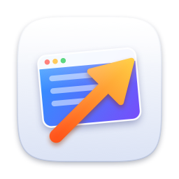
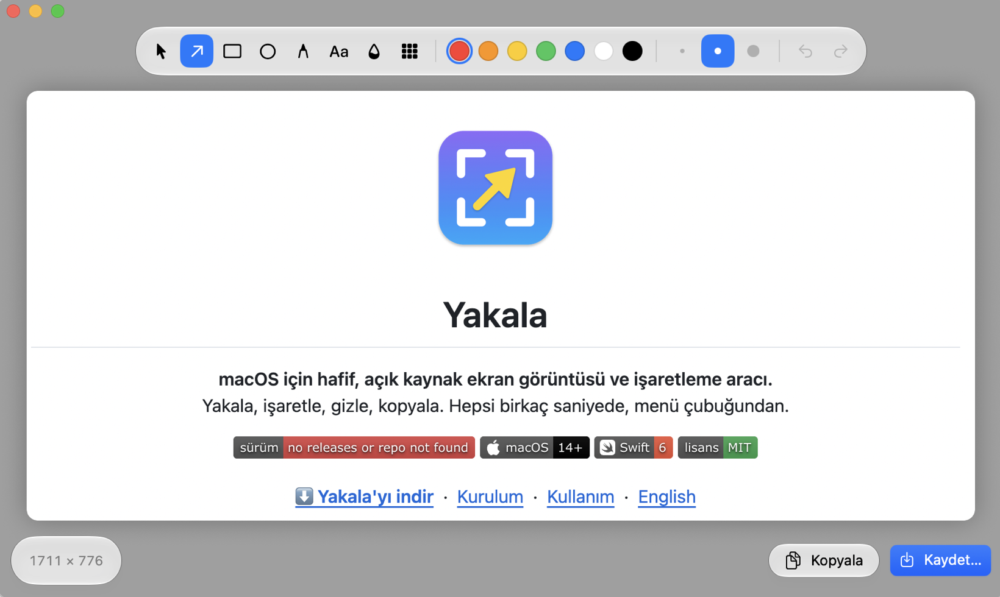

<p align="center">
  
</p>

<h1 align="center">Yakala</h1>

<p align="center">
  <b>macOS için hafif, açık kaynak ekran görüntüsü ve işaretleme aracı.</b><br>
  Yakala, işaretle, gizle, kopyala. Hepsi birkaç saniyede, menü çubuğundan.
</p>

<p align="center">
  <a href="https://github.com/mugione/Yakala/releases/latest"></a>
  
  
  <a href="LICENSE"></a>
</p>

<p align="center">
  <a href="https://github.com/mugione/Yakala/releases/latest"><b>⬇️ Yakala'yı indir</b></a>
  &nbsp;·&nbsp;
  <a href="#kurulum">Kurulum</a>
  &nbsp;·&nbsp;
  <a href="#kullanım">Kullanım</a>
  &nbsp;·&nbsp;
  <a href="#english">English</a>
</p>

<p align="center">
  
</p>

---

## Özellikler

- ⚡ **Tek kısayolla yakala.** **⇧⌘2**'ye bas, ekran donar; fareyle alanı seç. Tek tık tüm ekranı alır.
- ✏️ **İşaretle.** Ok, dikdörtgen, yuvarlak, kalem ve metin; 7 renk, 3 kalınlık.
- 🙈 **Gizle.** Şifreleri, e-postaları, kişisel bilgileri bulanıklaştır ya da pikselleştir.
- 📋 **Kopyala ve devam et.** ⌘C ile görüntü panoya gider, pencere kapanır ve çalıştığın uygulamaya dönersin: hemen ⌘V.
- 💾 **Otomatik kayıt.** İstersen her görüntü seçtiğin klasöre kendiliğinden kaydedilir.
- ↩️ **Geri al, taşı, düzenle.** Çizdiğin her şekil sonradan seçilip taşınabilir, rengi değiştirilebilir.
- 🖥️ **Birden fazla ekran** ve Retina çözünürlüğü desteklenir.
- 🔒 **Gizliliğe saygılı.** Yakala internete bağlanmaz, veri toplamaz; görüntüler yalnızca senin Mac'inde kalır.
- 🪶 **Hafif ve yerel.** Swift ile yazıldı, Dock'ta yer kaplamaz, menü çubuğunda sessizce bekler. macOS 26 ve sonrasında Liquid Glass görünümüyle.

## Kurulum

1. [Son sürümü](https://github.com/mugione/Yakala/releases/latest) aç ve **`Yakala-<sürüm>.dmg`** dosyasını indir.
2. DMG'yi aç ve **Yakala**'yı yanındaki **Uygulamalar** klasörüne sürükle.
3. Yakala'yı Uygulamalar'dan veya Spotlight'tan aç.

> [!IMPORTANT]
> **İlk açılışta "Yakala doğrulanamadı" uyarısı görürsen:** Bu beklenen bir durum. Yakala ücretsiz ve açık kaynak
> olduğu için ücretli Apple Developer ID ile imzalanmıyor. Açmak için:
>
> 1. Uyarıyı **Bitti** ile kapat.
> 2. **Sistem Ayarları › Gizlilik ve Güvenlik**'i aç, aşağı kaydır.
> 3. "Yakala engellendi" satırındaki **Yine de Aç**'a tıkla ve onayla.
>
> Bu işlem yalnızca bir kez yapılır. Terminal kullanmayı tercih edersen:
> `xattr -dr com.apple.quarantine /Applications/Yakala.app`

4. İlk yakalamada macOS **ekran kaydı izni** ister: **Sistem Ayarları › Gizlilik ve Güvenlik › Ekran Kaydı**
   bölümünden Yakala'yı aç. macOS "Çık ve Yeniden Aç" derse onu seç.

**Gereksinim:** macOS 14 Sonoma veya üzeri.

## Kullanım

Yakala menü çubuğunda bir simge olarak çalışır; Dock'ta görünmez.

| Ne yapmak istiyorsun? | Nasıl? |
|---|---|
| Alan seçip yakalamak | **⇧⌘2** veya menü çubuğu simgesine tıkla, sonra sürükle |
| Tüm ekranı yakalamak | Alan seçerken sürüklemeden **tek tıkla** |
| Vazgeçmek | **Esc** veya sağ tık |
| Panoya kopyalamak | Düzenleyicide **⌘C**: pencere kapanır, önceki uygulamana dönersin |
| Kaydetmek | **⌘S**. Bir kez kaydettikten sonra ⌘S aynı dosyayı günceller; **⇧⌘S** yeni dosya |
| Geri almak / yinelemek | **⌘Z** / **⇧⌘Z** |
| Menüyü açmak | Simgeye **sağ tık**: Tüm Ekranı Al, Son Görüntüyü Göster, Ayarlar…, Hakkında |

### Düzenleyici araçları

| Araç | Tuş | İpucu |
|---|:-:|---|
| Seç ve taşı | `V` | Şekli sürükle; ok tuşlarıyla kaydır (Shift ile 10 kat); Delete ile sil |
| Ok | `A` | Shift: 45°'lik açılara kilitlenir |
| Dikdörtgen | `R` | Shift: kare |
| Yuvarlak | `O` | Shift: daire |
| Kalem | `P` | Serbest çizim, otomatik yumuşatılır |
| Metin | `T` | Tıkla ve yaz; Enter kaydeder. Var olan yazıya tıklayınca düzenlersin |
| Bulanıklaştır | `B` | Gizlenecek alanı sürükle |
| Pikselleştir | `X` | Yazıları gizlemek için bulanıklaştırmadan daha güvenli |

Renk ya da kalınlık seçtiğinde bir şekil seçiliyse o şekil de değişir.

### Ayarlar

Simgeye sağ tık › **Ayarlar…** (⌘,):

- **Mac açılınca Yakala'yı başlat**
- **Kayıt klasörü**: varsayılan `~/Pictures/Yakala`
- **Her ekran görüntüsünü otomatik kaydet**

## Sık sorulan sorular

<details>
<summary><b>Menü çubuğunda Yakala'nın simgesini göremiyorum.</b></summary>

Çentikli MacBook'larda menü çubuğu doluysa soldaki simgeler çentiğin arkasında kalır. **⇧⌘2** simge olmadan da
çalışır. Simgeyi geri getirmek için ⌘ tuşuna basılı tutarak başka simgeleri menü çubuğunun dışına sürükle ya da
**Sistem Ayarları › Menü Çubuğu**'ndan gerekmeyenleri kapat. Yakala çalışırken onu Spotlight'tan yeniden açmak
Ayarlar penceresini getirir.
</details>

<details>
<summary><b>İzin verdim ama Yakala hâlâ ekran kaydı izni istiyor.</b></summary>

İzni verdikten sonra Yakala'yı kapatıp yeniden açman gerekir. Sorun sürerse izni sıfırlayıp tekrar ver:

```bash
tccutil reset ScreenCapture io.github.mugione.Yakala
```
</details>

<details>
<summary><b>Görüntüler nereye kaydediliyor?</b></summary>

Varsayılan olarak `~/Pictures/Yakala` klasörüne. Ayarlar'dan değiştirebilirsin. Masaüstü, Belgeler veya
İndirilenler'i seçersen macOS ilk kayıtta bu klasöre erişim izni ister.
</details>

<details>
<summary><b>Yakala internete bağlanıyor mu?</b></summary>

Hayır. Hiçbir ağ isteği yapmaz, analiz ya da kullanım verisi toplamaz. Kodun tamamı bu depoda.
</details>

## Kaynaktan derleme

Derlemek için **Xcode 26** veya üzeri gerekir.

```bash
git clone https://github.com/mugione/Yakala.git
cd Yakala
./build.sh --install
```

| Komut | Ne yapar? |
|---|---|
| `./build.sh` | `build/Yakala.app` oluşturur |
| `./build.sh --open` | Derler ve proje klasöründen açar |
| `./build.sh --install` | Derler ve `/Applications`'a kurar (önceki Yakala kurulumunu günceller) |
| `./build.sh --dmg` | Derler ve dağıtılabilir `build/Yakala-<sürüm>.dmg` üretir |
| `swift test` | Testleri çalıştırır |

Kodu Xcode'da düzenlemek için `Package.swift` dosyasını Xcode ile aç.

> [!TIP]
> `build.sh`, Mac'inde bir **Apple Development** sertifikası varsa onunla imzalar (Xcode › Settings › Accounts ›
> Manage Certificates › **+**). Sertifika yoksa her derleme farklı imzalanır ve macOS ekran kaydı iznini her
> derlemeden sonra yeniden ister.

<details>
<summary><b>Proje yapısı</b></summary>

| Dosya | Görevi |
|---|---|
| `Sources/Yakala/AppDelegate.swift` | Menü çubuğu simgesi, menü, yakalama akışı |
| `Sources/Yakala/GlobalHotKey.swift` | Sistem genelinde ⇧⌘2 kısayolu (izin gerektirmez) |
| `Sources/Yakala/ScreenCapturer.swift` | ScreenCaptureKit ile ekran görüntüsü, kırpma |
| `Sources/Yakala/AreaSelector.swift` | Dondurulmuş ekran üzerinde fareyle alan seçimi |
| `Sources/Yakala/Annotation.swift` | Araçlar, renkler, şekil modeli ve geometri |
| `Sources/Yakala/AnnotationRenderer.swift` | Şekilleri çizer; ekranda ve dışa aktarmada aynı kod |
| `Sources/Yakala/EditorModel.swift` | Düzenleyici durumu, geri al / yinele, kopyala / kaydet |
| `Sources/Yakala/CanvasView.swift` | Tuval: fare, klavye, metin kutusu |
| `Sources/Yakala/EditorWindow.swift` | Düzenleyici penceresi ve yüzen çubuklar |
| `Sources/Yakala/FloatingStyle.swift` | Liquid Glass / material görünümü |
| `Sources/Yakala/Toast.swift` | "Panoya kopyalandı" bildirimi |
| `Sources/Yakala/ImageExporter.swift` | Panoya kopyalama, PNG yazma |
| `Sources/Yakala/AppSettings.swift` | Ayarlar ve girişte başlatma |
| `Sources/Yakala/SettingsWindow.swift` | Ayarlar penceresi |
| `Sources/Yakala/About.swift` | Hakkında paneli |
| `Support/` | `Info.plist`, uygulama simgesi ve simgeyi üreten betik |
| `Tests/YakalaTests/` | Çizim motoru, model ve kaydetme testleri |
</details>

### Yeni sürüm yayınlamak

1. `Support/Info.plist` içinde `CFBundleShortVersionString` değerini artır (ör. `1.1`).
2. `./build.sh --dmg` çalıştır.
3. GitHub'da **Releases › Draft a new release**: etiket `v1.1`, `build/Yakala-1.1.dmg` dosyasını ekle, yayınla.

## Katkıda bulunma

Hata bildirimleri, öneriler ve pull request'ler memnuniyetle karşılanır.
Bir hata bulduysan [Issues](https://github.com/mugione/Yakala/issues) bölümünden bildir.
Büyük bir değişiklik düşünüyorsan önce bir issue açıp konuşalım.

## Lisans

[MIT](LICENSE) © 2026 [mugione](https://github.com/mugione/)

---

<a id="english"></a>

## English

**Yakala** (Turkish for *"capture"*) is a lightweight, open-source screenshot and annotation tool for macOS.
It lives in the menu bar; the interface is in Turkish.

- **Capture:** press **⇧⌘2**, drag to select an area (single click for the whole screen).
- **Annotate:** arrow, rectangle, ellipse, pen and text; 7 colors, 3 line widths, undo/redo.
- **Redact:** blur or pixelate sensitive information.
- **Copy & go:** ⌘C copies the result, closes the editor and returns you to the previous app.
- **Private:** no network access, no analytics. Your screenshots never leave your Mac.

**Install:** download the latest `.dmg` from [Releases](https://github.com/mugione/Yakala/releases/latest)
and drag Yakala to Applications. Because the app is not signed with a paid Developer ID, macOS will block the
first launch: open **System Settings › Privacy & Security** and click **Open Anyway**. Then allow
**Screen Recording** when asked. Requires macOS 14 or later.

**Build from source** (Xcode 26+): `git clone https://github.com/mugione/Yakala.git && cd Yakala && ./build.sh --install`

Licensed under the [MIT License](LICENSE).
